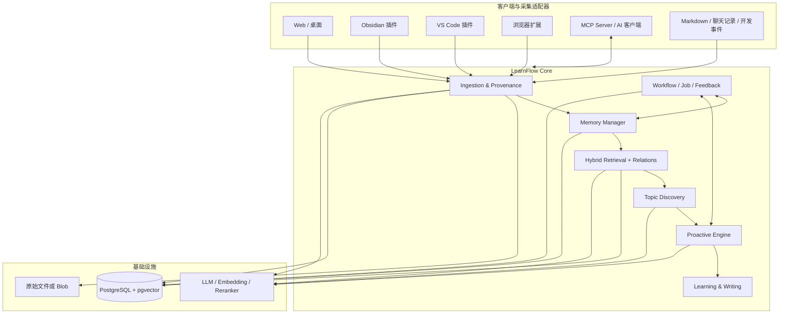
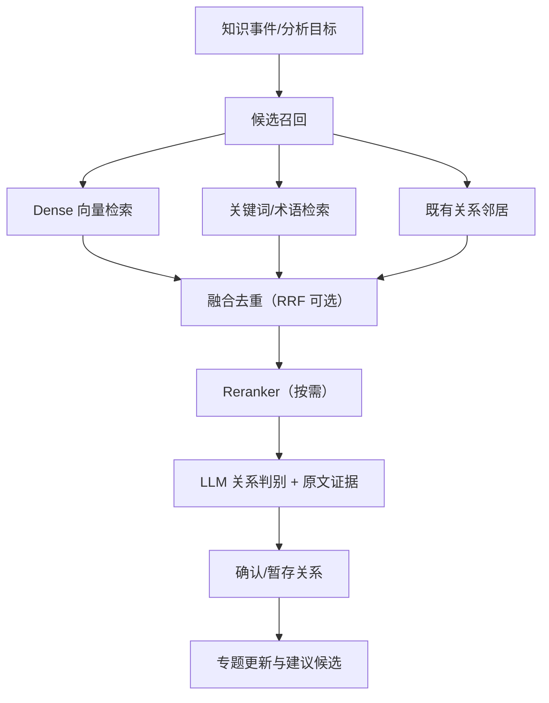
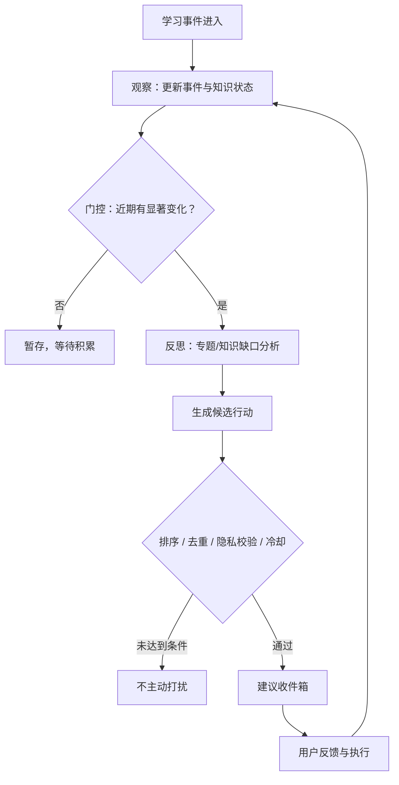

> **副标题：** Memory-driven · Knowledge-aware · Proactive Learning Agent  
> **版本：** V0.2（设计稿；部分技术选型仍待原型验证）  
> **整理日期：** 2026-11-19  
> **项目性质：** 本地优先、开源、自部署、面向开发者  
> **文档用途：** 产品共识、技术选型、原型实验、后续 AI 辅助编码  
> **资料依据：** 现有 V0.1 产品文档、前期 LearnFlow 讨论、2026-11-19 检索的官方文档与论文。文中明确区分**产品已确定目标**、**工程建议**和**待验证假设**。

---

## 阅读导航

- **先看**：第 1～3 章，理解产品定位、关键决策和系统分层。
- **技术重点**：第 5～10 章，分别是知识摄取、长期记忆、关联检索、主动推荐、上下文工程和 Agent 工作流。
- **开发落地**：第 11～15 章，涵盖模型、客户端与 MCP、数据接口、评测、MVP。
- **专题调研**：第 16～18 章，包含 Mem0、Graphiti、LightRAG、HippoRAG、论文、框架比较与阅读路线。
- **查资料**：第 19 章的官方链接与论文目录。

## 0. 执行摘要与决策状态

**产品定位（已确定）**：LearnFlow Agent 是面向开发者的主动式个人学习与知识成长系统。它持续理解用户在聊天、笔记、代码实践等场景中产生的学习记录，形成可追溯的长期记忆，发现跨时间、跨来源的知识关联与可能的学习机会，进而推动真实的实践和博客输出。

**核心闭环（已确定）**：知识采集 → 知识理解 → 长期记忆与关联 → 主动发现 → 用户确认 → 学习/实践/写作 → 反馈与新知识。

**交互形态（未定）**：独立 Web、Obsidian 插件、VS Code 插件、浏览器扩展、桌面端、MCP Server 均可作为客户端或接入方式；不因某一形态锁死核心引擎。

**工程路线（推荐，待验证）**：先做可独立运行的 LearnFlow Core；优先使用 Java/Spring Boot/Spring AI、PostgreSQL + pgvector、规则与 LLM 相结合的工作流；图数据库、多 Agent、复杂推荐模型和独立部署的记忆框架留待实验后再决定。

**最重要的验证问题（尚未证明）**：主动建议是否比“普通笔记搜索 + 每周总结”更有用，且不会产生令人厌烦的重复建议？

### 0.1 本版本相对 V0.1 的新增内容

| 内容                  | V0.1 状态    | V0.2 补充                                                      |
| ------------------- | ---------- | ------------------------------------------------------------ |
| 客户端形态               | 以独立 Web 为主 | 统一 Core、多客户端适配，首个客户端待定                                       |
| 长期记忆                | 分层概念       | 学习事件、证据、状态推导、记忆冲突与失效                                         |
| 知识关联                | 向量检索 + 关系表 | 混合召回、重排、关系判断、图增强检索预研                                         |
| 主动 Agent            | 功能描述       | 观察—分析—决策—行动、门控、冷却、反馈                                         |
| Context Engineering | 未明确        | 逐级加载上下文、摘要与证据分离                                              |
| 技术调研                | 较少         | Mem0、Graphiti、Letta、GraphRAG、LightRAG、HippoRAG 2、论文与 Java 框架 |
| 评测                  | 定性描述       | Gold Set、离线回放、消融实验和指标                                        |
| 工程实现                | 模块建议       | 接口草案、事件模型、任务状态、MVP 切片                                        |

---

# 第一部分：产品定义与业务边界

## 1. 产品定位与原则

### 1.1 问题与目标

程序员的学习证据分散在 AI 聊天、Markdown、代码仓库、技术文章和工作日志中。传统笔记软件善于**记录与检索**，但通常缺少跨时间的知识状态判断、知识之间的长期联系和对后续行动的主动建议。

LearnFlow 的目标不是自动生成越来越多的笔记，而是帮助用户回答：

1. 我最近究竟学了什么、解决过哪些真实问题？
2. 几次看似零散的学习是否构成同一个技术专题？
3. 哪些知识还缺少实验证据或实际应用？
4. 哪些专题已经值得写成文章、做成 Demo 或继续深入？
5. 下一步建议是否有依据、是否值得现在打扰我？

### 1.2 五个确定的产品能力

| 核心能力 | 产品含义 | 最低可见成果 |
|---|---|---|
| 多源知识采集 | 纳入散落在不同位置的用户学习记录 | 可导入、追踪来源、正确更新与删除 |
| 长期记忆 | 理解事件发生过程与学习状态演化 | 能说出某主题的学习过程及证据 |
| 知识关联 | 发现跨记录概念、实践和问题的联系 | 能解释为何推荐组成一个专题 |
| 主动式 Agent | 在合适时机识别有价值的下一步 | 提出少量高价值、有依据的建议 |
| 学习输出闭环 | 促进实践、博客与可验证的成果 | 从知识碎片走到用户自主完成的文章/实验 |

### 1.3 设计原则

- **先证据后推断**：每条重要结论都应能跳转原始记录；“没有记录”不是“没有掌握”。
- **人负责学习，Agent 负责促进**：提供选题、大纲、缺口、实验建议与校对，不默认一键代写或发布。
- **本地优先，隐私分级**：数据默认由用户掌控，敏感记录不得未经授权上传第三方模型。
- **核心与客户端解耦**：Obsidian、Web、VS Code、MCP 均是接入层而非业务事实源。
- **增量与可恢复**：文件编辑、重复导入、改名、删除、失败重试均应有明确处理逻辑。
- **主动但克制**：默认把建议放入收件箱，不因每条笔记变动而弹窗。
- **逐步引入复杂度**：只有在对比实验显示确有收益时，才加图数据库、多 Agent 或复杂调度框架。

### 1.4 非目标（MVP 不做）

全量浏览器记录监控、所有 AI 聊天平台自动同步、多用户协作、SaaS 计费、跨端实时同步、复杂知识图谱手工编辑、自动批量发布博客、无监督代码执行、自建模型训练、完全自主的多 Agent 社会系统。上述功能可保留接口，不进入首期交付。

## 2. 目标用户与端到端场景

初期用户是持续学习后端、AI 应用、算法、基础设施等技术的个人开发者。核心路径不是闲聊问答，而是连续积累—发现关联—采取行动。

**典型案例：Java 异步编程**

- 第 1 天：用户在聊天中询问线程池核心参数。
- 第 4 天：记录 `CompletableFuture` 并行调用的学习笔记。
- 第 9 天：在实际项目中处理异步调用超时。
- 第 12 天：修复异常没有正确传播的问题，并提交代码。
- 系统关联出“Java 异步任务编排”专题，附四条来源证据，提示“已有概念 + 实践，缺少实验对比”；
- 用户选择“加入学习计划”，完成异常处理与性能测试，自己撰写博客；
- 系统把新实验记录为情景记忆，并将建议状态更新为“已执行”。

**成功标准**：不仅给出一个看似合理的标题，还能解释“为什么是这个专题”“依据哪几条历史记录”“具体缺什么”“用户做完以后系统如何更新”。

## 3. 系统分层与技术路线

### 3.1 总体架构（推荐）



**架构要点**：`Core` 不直接调用 Obsidian Vault API、VS Code API 或 React 组件；适配器将来源转换为统一的 `SourceEvent`，把 Agent 结果转换成客户端可呈现的 `Suggestion`。MCP 负责外部 AI 互操作，不取代 Core 自身的内部调用。

### 3.2 首选技术（候选方案，不是不可变约束）

| 层          | 首选                        | 备选 / 演进条件                         |
| ---------- | ------------------------- | --------------------------------- |
| Core / API | Java + Spring Boot        | TypeScript 全栈：仅当插件一体化和安装成本成为更高优先级 |
| 模型抽象       | Spring AI 稳定版             | LangChain4j：用相同任务对比体验和接口成熟度       |
| 工作流        | Java Service + 数据库任务状态    | LangGraph4j：出现复杂分支、长期中断与恢复需要后再引入  |
| 结构化存储      | PostgreSQL                | SQLite：最轻量的本地单机原型备选               |
| 语义检索       | pgvector                  | 其他向量存储：仅在规模或检索需求出现瓶颈后替换           |
| 知识关系       | PostgreSQL 关系表            | Graphiti / 图数据库：时序多跳查询收益明确时引入     |
| LLM        | 可配置云端 + 本地推理              | 不绑定服务商，支持隐私策略路由                   |
| Embedding  | Qwen3-Embedding-0.6B 基线   | BGE-M3 对照；以自有测试集决定                |
| Reranking  | 可选 Cross-Encoder / LLM 重排 | MVP 无必要强制开启，先测召回质量                |
| 运行方式       | 单机 Core + 本地数据库           | 后续提供轻量无服务版 / Docker Compose       |

**兼容性提醒**：截至 2026-11-19，Spring AI 官方文档标示 2.0.2 为稳定版，2.1.0-RC2 已发布但不应自动作为生产默认依赖；具体 Spring Boot / JDK 组合在创建项目时锁定并通过集成测试验证。[S01][S02]

---

# 第二部分：核心技术设计

## 4. 统一领域模型与数据边界

### 4.1 关键术语

| 术语 | 定义 | 与相近概念的区别 |
|---|---|---|
| SourceRecord | 一条原始资料（笔记、对话、事件） | 用户写的内容，尽量保持原貌 |
| SourceVersion | 来源的某一次修订 | 支持增量变更与删除失效 |
| LearningEvent | 可定位到时间的学习或实践事件 | 表示“发生过什么”，不直接代表掌握 |
| KnowledgeAtom | 从来源中抽取的知识陈述或问题 | 可以由多条证据支持 |
| KnowledgeEvidence | 知识陈述和原文位置的对应关系 | 防止无来源的记忆膨胀 |
| KnowledgeRelation | 知识之间有类型的关联 | 不等同于向量相似度 |
| Topic | 聚合多个知识单元的学习专题 | 可以是系统候选，也可以用户确认 |
| LearningState | 某主题的当前学习状态 | 从事件与证据推导，可被纠正 |
| MemoryFact | 与用户、主题有关的长期事实 | 有有效性、来源与可信状态 |
| Suggestion | Agent 的一条候选行动建议 | 与系统动作、通知和学习任务分离 |
| FeedbackEvent | 用户对建议或知识的操作反馈 | 是后续推荐的重要证据 |

### 4.2 存储的事实源

**建议采用“来源优先、派生数据可重建”原则**：

1. 原始用户笔记、聊天记录等内容是业务事实源；保留来源 URI、版本、导入时间及删除状态。
2. 向量、知识单元、主题摘要、推荐候选是**派生索引**，可以从来源重建。
3. 用户明确填写的学习目标、手工编辑的文章、主动纠正的知识结论属于用户主数据，不能在重建时覆盖。
4. 外部文件可能不在 LearnFlow 自身存储中，需保留稳定的来源定位及失效策略。
5. 同一知识单元可能有多个来源，不应在删除一篇笔记时无条件删除仍由其他证据支持的知识。

### 4.3 基础表（逻辑结构，非直接可执行 DDL）

| 实体 | 关键字段 | 关键约束 |
|---|---|---|
| `source_record` | id, connector_id, external_id, source_uri, privacy_level, deleted_at | `(connector_id,external_id)` 唯一；保留来源归属 |
| `source_version` | id, source_id, content_hash, revision, imported_at, content_ref | 一个来源多版本；同版本重复处理幂等 |
| `source_chunk` | id, source_version_id, chunk_index, text, start_offset, end_offset | Chunk 与版本绑定；原文偏移可追溯 |
| `learning_event` | id, event_type, occurred_at, recorded_at, evidence_id, actor | 明确实际时间和入库时间 |
| `knowledge_atom` | id, canonical_title, statement, kind, validation_status | 概念、疑问、实践、问题与解法分开 |
| `knowledge_evidence` | id, knowledge_id, source_chunk_id, span, evidence_type | 一条陈述可以有多条证据 |
| `knowledge_relation` | id, src_id, dst_id, type, confidence, review_status, evidence_ref | 关系方向与证据必须明确 |
| `topic` / `topic_knowledge` | id, title, lifecycle_status / topic_id, knowledge_id | 多对多；系统候选与用户确认区分 |
| `learning_state` | subject_id, state, derived_from, updated_at, override_flag | 推断状态与用户确认状态不可混淆 |
| `memory_fact` | id, subject, predicate, value, valid_from, valid_to, source_id | 可被新证据取代，但保留历史 |
| `suggestion` | id, type, topic_id, rationale, score, status, expires_at, fingerprint | 避免相似推荐重复出现 |
| `feedback_event` | id, target_type, target_id, action, created_at | 可用于后续效果评估 |
| `async_job` | id, job_type, idempotency_key, state, retry_count, last_error | 可恢复、可重试、可观测 |

### 4.4 状态不等于事实

系统应明确区分：`MENTIONED`（被提及）、`ASKED`（曾提问）、`STUDIED`（已学习）、`PRACTICED`（有实践记录）、`VERIFIED`（有用户确认或检查证明）。这里是内部**证据状态标签**，不应直接当成精确的学习能力评分。

例如用户问“ConcurrentHashMap 为什么线程安全？”只支持“用户提出过此问题”，不足以判断“用户掌握了 ConcurrentHashMap”。用户在项目中实现并验证过相关功能，则可增加实践证据；是否“掌握”仍允许用户纠正。

## 5. 知识采集与增量更新（Ingestion）

### 5.1 统一接入契约

各客户端输出同一种事件格式，避免在核心模块中写平台特例：

```json
{
  "eventId": "evt-...",
  "sourceType": "markdown|chat|code_event|web",
  "sourceId": "connector-namespace/stable-id",
  "eventType": "UPSERT|DELETE|MOVE",
  "sourceUri": "obsidian://...",
  "occurredAt": "2026-11-18T14:00:00+08:00",
  "observedAt": "2026-11-19T10:00:00+08:00",
  "contentHash": "sha256:...",
  "privacyLevel": "LOCAL_ONLY|CLOUD_ALLOWED",
  "payloadRef": "file://..."
}
```

`sourceId` 应优先使用稳定标识；文件路径用于定位，不宜单独充当跨改名的永久身份。聊天平台无法稳定确定 ID 时，可使用来源 + 内容指纹等组合进行近似识别，并记录歧义。

### 5.2 增量处理链路

```text
变更事件 → 防抖/合并 → 版本检测 → 生成任务 → 解析与切分
      → 候选知识抽取 → 关联已有知识 → 存储证据与索引
      → 更新专题摘要 → 判断是否触发主动分析
```

工程要求：

- **幂等**：`source_id + version_hash + pipeline_version` 对同一次处理唯一。
- **失败恢复**：任务状态 `PENDING/RUNNING/SUCCEEDED/FAILED/RETRY`；禁止静默吞错。
- **删除/改名**：失效旧版本 Chunk，更新来源 URI；检查哪些知识仍有其他证据。
- **避免循环写入**：适配器写笔记时标注操作来源，防止写入—监听—再写入的无限触发。
- **重建索引**：Embedding 模型、解析逻辑或抽取 Prompt 改变时，支持按版本重建。
- **成本控制**：禁止每次击键都触发 LLM；批量导入限流、分批处理。
- **数据权限**：任何云端调用发生前先完成隐私级别筛查。

### 5.3 MVP 的数据源

首期支持 `Markdown`、手动文本和导出的聊天记录；Obsidian / VS Code / 浏览器的实时适配器属于后续客户端阶段。MVP 不对聊天平台可用的自动读取接口作未经确认的假设。

## 6. Agent Memory：长期记忆的核心设计

### 6.1 记忆类型与 LearnFlow 的映射

记忆领域常见分类为语义、情景和程序性记忆，另有用于当前任务的工作记忆。[M01]

| 类型 | 在 LearnFlow 中保存什么 | 示例 |
|---|---|---|
| Working Memory | 当前任务上下文、当前检索结果、执行状态 | 本次分析“Java 异步”专题所用的 12 条证据 |
| Semantic Memory | 相对稳定的知识状态与用户目标 | 用户正在系统学习 Java 并发、希望完成技术博客 |
| Episodic Memory | 带时间和来源的经历 | 某日修复了 `CompletableFuture` 超时问题 |
| Procedural Memory | Agent 的规则、流程及经确认的交互偏好 | 推荐必须有引用、避免重复弹窗 |

**推荐策略**：以情景记忆为事件基础，以语义记忆为可更新的摘要视图。避免把模型猜测自动固化为“用户已掌握”。

### 6.2 记忆写入与合并

```text
新来源/事件
   ↓ 抽取候选事实与情景事件
   ↓ 检索相关已有记忆与来源
   ↓ 校验来源、相似度、时间与冲突
   ├─ 相同事实 → 增加新证据，不复制无意义条目
   ├─ 新事实   → 创建记忆
   ├─ 状态变化 → 保留旧状态历史并更新当前有效视图
   └─ 不确定   → 标为待确认
   ↓ 更新用户画像/专题记忆
```

不能假设所有“长期记忆框架”都支持同一种更新机制。例如 **Mem0 的当前新一代 OSS/Platform 文档展示了 ADD-only 提取与历史/实体辅助检索的路线**；旧版曾使用更显式的 ADD/UPDATE/DELETE 合并流程，阅读仓库时必须辨别具体版本。[M02][M03]

### 6.3 时间与冲突

对 LearningEvent 使用两类时间：

- `occurred_at`：事件实际发生时间；来自源资料，可能未知。
- `recorded_at`：系统知道该事件的时间。

对可失效的事实增加 `valid_from/valid_to`；例如“正在准备 X”后来变成“已经完成 X”。保留原有来源，不把历史状态直接覆写丢失。借鉴 Graphiti 的时序事实与来源 Episode 设计，但不要求 MVP 搭建完整时序图数据库。[M04]

### 6.4 记忆质量治理

- **更正**：用户可以修改错误推断，写入人工校正证据。
- **冲突**：不同来源冲突时并列保存、标注冲突，不无依据选一条。
- **删除**：按来源失效记忆引用；只有无证据且非人工保存的派生事实才自动清除或降级。
- **过时**：把版本化技术事实与长期学习目标区分，需能标注知识的适用版本。
- **压缩**：专题摘要可滚动更新，但重要推断应保留原文证据定位。
- **隐私**：用户可按 Vault、项目、来源选择本地处理或允许云端处理。

### 6.5 为什么不直接全盘引入 Mem0 / Graphiti？

Mem0 是通用记忆层，Graphiti 更擅长时序关系管理；LearnFlow 还需要“学习事件—知识证据—学习状态—主动建议”的领域语义。建议先实现这一套最小领域模型，再用它们做对照实验：质量显著提升且部署成本可接受时才替换内部实现。

## 7. 知识关联、Hybrid RAG 与 GraphRAG

### 7.1 先区分三个问题

1. **召回**：哪些记录可能与当前主题相关？——向量检索、关键词检索。
2. **判别**：这些记录是什么真实关系？——类型约束、LLM 判断、证据核查。
3. **发现**：跨多个记录是否形成新专题或行动机会？——关系遍历、专题聚合、主动分析。

只有第 1 步不是“知识关联”。向量相似 ≠ 技术依赖关系 ≠ 用户确已掌握。

### 7.2 推荐的检索流水线



**MVP**：PostgreSQL + pgvector + 关系表；保留关键词检索。技术词、代码标识符对精确匹配敏感，例如 `CompletableFuture`、`@Transactional`、`ConcurrentHashMap`。对于中文内容，需要专门验证关键词分词或替代索引策略；不能只按英文全文检索默认设置评估。[R01]

### 7.3 关系类别与校验

建议先支持 `RELATED_TO`、`PREREQUISITE_OF`、`APPLIED_IN`、`SOLVES`、`SIMILAR_TO`。每个关系至少保存：来源两端、关系类型、候选模型、置信度、证据、用户审核状态。`PREREQUISITE_OF` 等强语义关系必须谨慎自动生成。

### 7.4 GraphRAG 项目的启发

- **Microsoft GraphRAG**：实体关系提取、社区摘要与全局检索；其仓库声明以维护为主且索引成本可能较高，适合作研究，不宜作为个人项目默认依赖。[R02]
- **LightRAG**：图结构与向量的组合、增量更新；优先研究其如何维护新文档带来的实体与关系变化。[R03]
- **HippoRAG 2**：借鉴多跳关联与 Personalized PageRank 的图传播重排；适用于“间接相关但很有用”的资料发现。[R04]

**引入条件**：只有在真实数据集上证明“图增强检索”优于 Hybrid RAG 基线，且可接受额外索引成本，才考虑迁移到专门的图存储或图检索框架。

## 8. Proactive Agent：主动式学习引擎

### 8.1 与普通聊天 Agent 的区别

普通 Agent 等待用户任务；LearnFlow 应从学习事件中识别潜在需求，判断**是否值得现在提出建议**。主动性不仅是“定时总结”，而是观察、反思、决策、触达和反馈的循环。

参考方向：Generative Agents 的 Observation / Reflection / Planning，以及主动式 Agent 相关研究中对任务能力、时机和用户信任的关注。[P01][P02][P03]

### 8.2 五阶段流程



### 8.3 触发源与门控

**触发源**：新知识批量导入完成、同一主题持续出现新事件、用户指定回顾周期、一个已接受的学习任务有新成果、用户手动请求分析。

**基础门控**（初期规则足够）：

- 证据量是否达到最低阈值，且来自至少两个不同事件？
- 最近是否已经出现同类建议？
- 用户是否曾拒绝此类建议或明确不想被打扰？
- 是否与用户当前目标有关，是否能提出具体行动？
- 当前调用是否违反数据权限或预算？

门控条件应可配置且有测试，不应以硬编码“新增 3 条笔记即弹窗”代表真正的主动性。

### 8.4 建议价值评分（项目拟议方案，非文献原公式）

\[
U(s) = w_R R + w_E E + w_A A - w_D D - w_C C
\]

- `R`：与目标相关性；`E`：证据充分性；`A`：下一步行动可执行性；
- `D`：历史相似建议重复惩罚；`C`：打扰成本与执行成本。

**先做硬约束过滤，再排序**。例如“无证据”“权限不足”“已明确拒绝”的建议不得靠高分绕过。初期权重人工设定，利用真实反馈做校准，暂不训练个性化推荐模型。

### 8.5 建议输出契约

每条建议应至少提供：`type`、`title`、`reason`、`evidenceIds`、`currentAssets`、`hypothesizedGaps`、`nextActions`、`confidence`、`status`、`fingerprint`。

示例：

> 推荐：《Java 异步任务编排实践》。依据：用户最近在三个独立来源记录了线程池配置、并行接口调用、异常处理；其中一条是实际项目问题。可能需要补充：异常恢复方案对比与性能实验。下一步：先完成一个可复现实验。此推荐是“可选行动”，不是“用户不懂异常处理”的诊断。

### 8.6 通知与信任

默认写入**建议中心**，定期合并为摘要；弹窗和系统通知需用户主动启用。记录 `shown_at`、`dismissed_at`、`accepted_at`、`completed_at`，支持“少推荐这个领域”“这个关系错了”“已经会了”。不要将用户未回应视为否定反馈。

## 9. Context Engineering：面向记忆的上下文工程

### 9.1 原则

不是把整个 Vault 或全部聊天记录塞进 Prompt，而是为当前任务加载**足够、相关、可追溯、经许可**的信息。

推荐五级上下文：

1. 用户目标与隐私策略（简短、稳定）。
2. 当前专题的记忆摘要（滚动更新，带版本）。
3. 最近的相关学习事件与用户反馈。
4. 混合检索得到的 KnowledgeAtom 和证据片段。
5. 必要时回溯原始 Markdown / 聊天记录 / 代码。

### 9.2 关键机制

- **选择**：依据任务选择记忆，避免“相关性低但时间最近”的噪声。
- **预算**：给不同上下文层设置 Token 上限；超出时优先保留原始证据引用和关键关系。
- **摘要**：为 Topic 维护 `summary`, `key_concepts`, `practice_evidence`, `unresolved_questions`, `updated_at`, `source_refs`。
- **压缩**：压缩前要能追溯原文，不能仅把摘要再反复总结成摘要。
- **隔离**：不同权限、不同来源、不同用户的内容必须逻辑隔离；MVP 即使单人也应保留数据作用域字段。
- **拒绝不可信指令**：导入网页和笔记是数据，不得当成 Agent 工具权限指令。

### 9.3 MVP 建议

先实现 `ContextAssembler`：给定任务与主题，输出结构化上下文包及其来源列表，并记录检索链路、Token 使用和删减原因。以后不论底层使用哪种 Agent 框架，该接口都应稳定。

## 10. Agent 工作流、任务恢复与人工介入

### 10.1 不先追求多 Agent

首期的大多数任务可拆成确定步骤：`解析 → 抽取 → 检索 → 校验 → 写入 → 决策 → 推送`。更合适的是**固定工作流 + 工具调用 + 有限的 LLM 判断节点**，而不是多个无限循环的自主 Agent。

### 10.2 主要工作流

| 工作流 | 输入 | 输出 | 失败与恢复边界 |
|---|---|---|---|
| `IngestSource` | SourceEvent | SourceVersion、Chunks | 同版本重复提交不会重复写入 |
| `ExtractKnowledge` | SourceVersion | 候选 KnowledgeAtom + Evidence | 输出结构校验，失败进入重试队列 |
| `LinkKnowledge` | 新知识 | Relation 候选与证据 | 关系不确定则不自动确认 |
| `ConsolidateMemory` | LearningEvent + 证据 | 最新有效记忆视图 | 保留历史，可撤销派生更新 |
| `DiscoverTopics` | 新知识 + 相关历史 | 候选 Topic | 可按专题单独重跑 |
| `GenerateSuggestions` | Topic + Goal + Feedback | 建议候选 | 规则过滤和重复控制 |
| `DraftAssist` | Topic + 用户确认 | 大纲、素材、缺口 | 不自动覆盖用户文章 |

### 10.3 编排技术选择

- **MVP**：Spring Service、数据库任务表、状态机枚举、幂等键、定时 Worker；容易调试和部署。
- **扩展**：LangGraph4j 可提供图式编排、Checkpoint 与恢复，并有 Spring AI 适配；当跨天任务、暂停等人工审核节点较多时再验证。[F03]
- **备选**：Spring AI Alibaba / LangChain4j 有相应 Agent/Graph/RAG 能力，按团队语言、依赖成熟度和需求评价，而非叠加使用。

### 10.4 Human-in-the-loop

区分四类动作：`READ_ONLY`（检索）、`DERIVED_WRITE`（更新可重建索引）、`USER_CONTENT_WRITE`（改写笔记）、`EXTERNAL_ACTION`（发布/执行代码）。后两者默认必须明确确认。所有模型工具动作应有审计记录。

## 11. 模型、Embedding、Reranking 与本地优先

### 11.1 模型能力抽象

```text
ModelGateway
├── ChatModel          # 解释、分类、建议生成
├── StructuredOutput   # 知识提取与关系判别
├── EmbeddingModel     # 语义召回
└── RerankModel        # 候选重排，可选
```

对每个任务独立配置 Provider、模型 ID、超时、重试、预算、隐私策略和 Prompt/Schema 版本。

### 11.2 关注的本地模型

| 模型/工具 | 角色 | 研究重点 |
|---|---|---|
| Qwen3-Embedding-0.6B | 首选 Embedding 基线 | 中英混合技术笔记、代码术语、资源占用 [L01] |
| BGE-M3 | Embedding 对照 | Dense、Lexical、Multi-Vector 多功能检索 [L02] |
| Qwen3-Reranker-0.6B | 排序候选 | 对 Top-K 相关笔记是否更准 [L03] |
| llama.cpp | 本地推理服务 | 兼容的生成、Embedding、Rerank 服务接口 [L04] |
| 云端大模型（可替换） | 更复杂的知识关系推断 | 质量、延迟、成本、隐私对比 |

注意：Reranker 不能找回**召回阶段漏掉的文档**，它只改变已召回候选的排序。Embedding 更换模型时要保存 `embedding_model_id`、维度、索引版本并重建索引。

### 11.3 隐私规则（强制）

- 默认本地保存原始数据；`LOCAL_ONLY` 内容不得进入云端模型请求或外部可观测性服务。
- API Key、Token、密码和私有代码可做检测，但**检测/脱敏不能替代明确授权**。
- 模型路由发生前先在应用层检查权限；使用可配置白名单，而不是任意内容自动发远程 URL。
- 单机自部署不等于模型离线；文档必须明确默认使用什么模型、是否联网、怎样完全离线运行。

## 12. 多客户端与 MCP 集成

### 12.1 交互形式选择（均是候选，不是既定路线）

| 实现形式 | 优点 | 局限 | 对应价值 |
|---|---|---|---|
| 简易 Web | 不依赖笔记平台，演示与测试方便 | 需要自建基本界面 | 首个原型可选 |
| Obsidian 插件 | 利用 Markdown/Vault/双链、适合博客写作 | 依赖宿主应用；后台常驻受限 | 知识输入和输出 |
| VS Code 插件 | 接近代码实践场景 | 权限与敏感代码处理更复杂 | 实践事件捕获 |
| 浏览器插件 | 技术阅读与网页知识采集便利 | 页面权限、动态网站、隐私挑战 | 多源知识采集 |
| MCP Server | 让其他 AI 客户端检索/写入 LearnFlow | MCP 本身不是用户界面或核心引擎 | 开放生态 |
| 独立桌面端 | 本地进程与系统通知可控 | 维护成本更高 | 后续完整体验 |

### 12.2 MCP 工具初步设计

建议只作为 Core 外部适配：

- `learnflow_search_knowledge(query, scope)`
- `learnflow_get_topic(topic_id)`
- `learnflow_get_learning_profile(scope)`
- `learnflow_list_suggestions(status)`
- `learnflow_record_learning_event(event)`（显式授权）
- `learnflow_create_learning_task(suggestion_id)`（显式确认）

工具实现必须校验调用者授权、来源权限和返回数据范围。官方 MCP 2026-07-28 规范已经更新了协议与授权设计，开发时以选定 SDK 对应规范为准。[C01]

### 12.3 接口稳定性的关键

- 客户端只依赖公开 API DTO，不直接访问数据库表。
- 文件系统、编辑器、MCP 的能力封装在 `adapters/`。
- 展示层不存储业务事实的唯一副本。
- 若先做 Obsidian，也不应把 Vault 路径放入领域模型核心主键。

## 13. API 草案（供原型定义，不等于最终接口）

| Endpoint | 方法 | 用途 |
|---|---|---|
| `/api/v1/sources/events` | POST | 导入来源变更事件 |
| `/api/v1/jobs/{id}` | GET | 查看异步任务状态 |
| `/api/v1/knowledge/search` | POST | 混合检索知识 |
| `/api/v1/topics` | GET | 查看专题及聚合关系 |
| `/api/v1/topics/{id}/analyze` | POST | 手动触发专题分析 |
| `/api/v1/suggestions` | GET | 获取主动建议收件箱 |
| `/api/v1/suggestions/{id}/feedback` | POST | 记录接受/忽略/纠错 |
| `/api/v1/articles/from-topic` | POST | 用户确认后创建文章项目 |

**示例：建议响应**

```json
{
  "id": "sg_001",
  "type": "BLOG_TOPIC",
  "title": "Java 异步任务编排实践",
  "topicId": "tp_java_async",
  "reason": "相关记录来自 3 次学习、1 次项目实践",
  "evidenceIds": ["ev_11", "ev_18", "ev_23", "ev_31"],
  "hypothesizedGaps": ["异常恢复方案对比", "性能实验"],
  "nextActions": ["完成异常处理实验", "整理文章大纲"],
  "confidence": "MEDIUM",
  "status": "PENDING",
  "reviewRequired": true
}
```

**API 约束**：提供分页、幂等键、请求版本、敏感字段过滤和统一错误码；前期本地单人使用也应避免接口直接暴露未授权的 Vault 文件路径。

## 14. 评测、可观测性与实验

### 14.1 为什么要建立基线

如果只展示“模型生成了合理建议”，无法说明 LearnFlow 比传统 RAG、自动标签或每周摘要更有价值。需要真实标注集与可回放的测试事件流。

### 14.2 四类 Gold Set

| 类别 | 测试资料 | 核心指标 |
|---|---|---|
| 知识抽取 | 技术对话 + 笔记，人工标记概念/疑问/实践 | Precision/Recall、错误掌握判断率 |
| 知识关联 | 不同来源笔记，人工标记正确关系 | Relation Precision@K、无依据关系比例 |
| 记忆更新 | 多日事件、状态纠正、删除 | 最新状态正确率、冲突处理正确率、删除一致性 |
| 主动推荐 | 连续学习事件 + 用户偏好/拒绝反馈 | 有用率、接受率、重复率、打扰率、完成转化 |

建议从 **30～50 篇真实且可公开使用的技术笔记** 和 **8～12 组连续学习场景** 开始，人工标注高价值的知识关系和推荐预期。数量是**建议起点**，不是经过验证的行业标准。文本来自用户私密数据时，测试集只能留在本地或做安全匿名化。

### 14.3 消融实验

- A：纯文本检索 / 基础向量 RAG。
- B：A + 结构化知识提取。
- C：B + 长期情景记忆和状态更新。
- D：C + 显式知识关系及混合检索。
- E：D + 主动推荐门控、排序与反馈。

在固定测试集、相同模型预算下比较：质量、延迟、成本和重复建议比例。**不要把不同模型性能提升误认为记忆或图方法的收益。**

### 14.4 评测与追踪工具

- **Langfuse**：Tracing、Prompt/实验数据、人工和自动评测；可能引入额外部署开销，先保留标准 Trace，再按需自部署。[E01]
- **Ragas**：RAG 检索与答案忠实性相关指标；不等价于用户是否愿意执行建议。[E02]
- **DeepEval**：LLM/Agent 任务指标与回归测试；可选。[E03]
- **OpenTelemetry**：底层标准化 Trace/指标，先从普通调用链和模型调用日志做起。

**日志最少记录**：taskId、sourceVersionId、promptVersion、modelId、tokenUsage、retrievalCandidates、latency、decisionReason、privacyRoute、userFeedback。不得把 `LOCAL_ONLY` 原文自动发到第三方观测平台。

## 15. MVP 与分阶段实施

### 15.1 MVP 核心验证

> **给定多日、跨来源的真实学习记录，LearnFlow 能否产生有来源依据、可执行、低打扰的学习与博客选题建议？**

第一版产品只需展示一个完整闭环，不需要完整博客编辑器、复杂 Web 平台或多 Agent。

### 15.2 开发阶段

| 阶段 | 交付物 | 通过条件 |
|---|---|---|
| M0：准备 | 单仓库、Spring Core、最小 API、模型配置、测试样例 | 可以导入样例并完整记录任务 Trace |
| M1：采集与知识 | Markdown/聊天记录导入、来源版本、结构化抽取 | 重复导入、改名、删除等测试通过；抽取可追溯 |
| M2：记忆与关联 | 学习事件、知识状态、向量 + 关键词检索、Topic | 能正确连接多次学习记录，能纠正错误关系 |
| M3：主动建议 | 专题发现、缺口候选、去重门控、建议收件箱 | 预设场景中给出有证据的建议；不重复轰炸 |
| M4：学习输出 | 创建专题大纲、关联素材、记录实验和完成反馈 | 从建议走到用户完成一篇可审核的文章草稿 |
| M5：客户端扩展 | 按实际需求选 Web/Obsidian/VS Code/MCP | 客户端不复制核心业务逻辑 |

### 15.3 第一条演示链路

**输入**：线程池参数笔记、`CompletableFuture` 对话、项目中超时问题记录、异常修复总结。

**预期过程**：

1. 保留四条原始来源与版本。
2. 抽取概念、疑问与实践事件，不把提问自动当作掌握。
3. 发现跨来源关系，形成“Java 异步编程实践”候选专题。
4. 根据参考框架或用户目标提出可能的缺口，并明确它们是**建议**不是事实诊断。
5. 给出可执行博客选题，展示全部证据链接。
6. 用户接受/拒绝/纠错后，系统更新推荐状态；重复处理不会产生相同建议。

### 15.4 原型阶段需要优先做的技术实验

| 实验 | 对照方案 | 关键判定 |
|---|---|---|
| Embedding 基线 | Qwen3-Embedding-0.6B vs BGE-M3 | 中文技术笔记召回与资源占用 |
| 知识关联 | 向量 Top-K vs Hybrid + LLM 关系判断 | 错误关系率是否下降 |
| 记忆更新 | 普通摘要 vs 事件 + 证据 + 当前状态 | 纠错/时间变化是否更可靠 |
| 主动性 | 每周摘要 vs 事件门控建议 | 用户是否认为“少而有用” |
| 图增强 | 关系表遍历 vs LightRAG/HippoRAG 思路 | 多跳召回的增益是否抵得上复杂度 |

---

# 第三部分：Agent 技术与论文调研（供后续阅读）

## 16. 技术全景：哪些是基础能力，哪些是研究选项？

| 技术/项目 | 解决什么问题 | LearnFlow 借鉴点 | 结论 |
|---|---|---|---|
| Agent Memory | 历史事实与经历的持久化 | 学习事件、语义/情景记忆分层 | **P0 研究并实现领域模型** |
| Mem0 | 记忆提取、实体辅助检索、历史与去重 | 通用记忆流程、记忆生命周期 | **先读后做对照** |
| Graphiti | 时序关系、Episode、事实失效 | 时间版本 + 来源可追溯 | **借鉴设计，暂不强依赖** |
| Letta | 有状态 Agent、分层记忆 | 工作记忆与长期记忆管理 | **参考，不先迁移架构** |
| GraphRAG | 从文档中建实体关系与社区摘要 | 更高层次专题组织 | **研究方法，不直接作为底座** |
| LightRAG | 图与向量联合检索、增量建图 | 不同时间记录的关联 | **优先原型实验** |
| HippoRAG 2 | 多跳关联检索、图传播 | 找出间接关联的实践与概念 | **后续实验** |
| Hybrid Search | 关键词 + 语义召回 | 技术术语与概念均可检索 | **P0 建议** |
| Reranking | 精排候选 | 减少无关知识进入推理 | **P1，可选** |
| Proactive Agent | 无明确指令时发现价值 | 门控、时机、行动与反馈 | **P0 核心差异化** |
| Context Engineering | 限制并组织模型上下文 | 摘要 + 原文证据 + 分层检索 | **P0 建议** |
| MCP | 外部 AI 工具互通 | 复用 LearnFlow 长期记忆 | **P1/P2 接口适配** |
| Agent Evaluation | 评测与回归 | 证明新模块真的改善体验 | **从第一阶段建立** |

## 17. 重点开源项目深读卡片

### 17.1 Mem0 — Agent 长期记忆

**入口**：[Mem0 GitHub](https://github.com/mem0ai/mem0) ｜ [How It Works](https://docs.mem0.ai/core-concepts/how-it-works) ｜ [OSS 配置](https://docs.mem0.ai/open-source/configuration) ｜ [OSS v3 迁移说明](https://github.com/mem0ai/mem0/blob/main/docs/migration/oss-v2-to-v3.mdx)

**主要思路**：从对话/事件提取有价值的记忆，通过持久化和多信号检索支持后续个性化。新旧版本的“记忆如何合并/删除”策略存在变化，不能仅凭旧博客描述推断当前接口行为。[M02][M03]

**对本项目有帮助的点**：

- 知识抽取不能简单保存整段聊天。
- 写入时要和历史记忆比较，控制重复。
- 记忆需要元数据、时间、来源、作用域和检索条件。
- `user` 与 `assistant` 的陈述要区分，不能把模型说法直接变成用户事实。

**风险与限制**：它是通用 Agent Memory，而非学习能力评估引擎；部署时需要检查默认使用的 LLM、Embedding、向量服务是否联网。[M05]

**推荐读法**：先看当前 README、How It Works、OSS 配置，再看版本迁移文档；最后用十条学习事件写一个小 Demo。

### 17.2 Graphiti — 时序知识图谱

**入口**：[Graphiti GitHub](https://github.com/getzep/graphiti) ｜ [官方文档](https://help.getzep.com/graphiti/getting-started/welcome) ｜ [Episodes](https://help.getzep.com/graphiti/core-concepts/adding-episodes)

**主要思路**：将对话和外部数据转换为具有时间信息的实体与关系；通过 Episode 追踪来源，支持增量更新与混合检索。[M04]

**对本项目有帮助的点**：

- “用户正在学 X”和“用户已经做过 X”是不同时间下的状态。
- 维护 `occurred_at` 与 `recorded_at`，降低导入旧记录时的时间歧义。
- 用可失效的事实边或事实记录表达变化，保留历史而非无痕覆盖。

**风险与限制**：图数据库与 Python 生态的部署成本较高；“事实有效期”并不等于“用户能力真实提升”。

**推荐实验**：同一用户在三个时间点发生状态变化，比较“静态 JSON 记忆”和“事件 + 有效期”哪种更不容易引用旧事实。

### 17.3 Letta — 有状态 Agent 与分层记忆

**入口**：[Letta GitHub](https://github.com/letta-ai/letta) ｜ [官方文档](https://docs.letta.com/)

**主要思路**：把 Agent 的状态、记忆和工具操作做成长期持续的系统。值得借鉴其对工作上下文和持久记忆的边界设计，而非直接采用其全套运行时。

**阅读重点**：如何划分对话上下文、Agent 状态与长期存储；何时将当前上下文压缩、归档并重新检索；怎样让用户查看和控制重要记忆。

**风险**：LearnFlow 的主要任务并不是长期持续对话，直接复制通用对话型 Agent 的全套记忆管理可能让系统复杂化。

### 17.4 Microsoft GraphRAG — 社区摘要与全局知识组织

**入口**：[GraphRAG GitHub](https://github.com/microsoft/graphrag) ｜ [官方文档](https://microsoft.github.io/graphrag/)

**主要思路**：从大量文档建立实体图谱与社区层级摘要，从局部和全局两个尺度组织知识。

**最值得借鉴**：专题摘要、跨文档主题发现和“全局问题”检索思想。

**当前判断**：官方仓库声明项目以维护为主，且明确提示索引可能昂贵；LearnFlow 不宜直接整体引入。[R02]

### 17.5 LightRAG — 图 + 向量的增量检索

**入口**：[LightRAG GitHub](https://github.com/HKUDS/LightRAG)

**主要思路**：利用实体、关系及低层/高层检索组织知识，同时考虑增量文档处理。[R03]

**最值得借鉴**：新笔记进入系统后，如何更新既有知识图，而非每次重建；查询时如何将局部实体关系和更抽象的主题信息结合。

**风险**：图抽取依赖 LLM，对技术术语的实体消歧、成本和错误关系仍需测试；不能只凭 Demo 决定引入。

**建议实验**：在相同的 30～50 篇学习记录中，比较 pgvector + 关系表和 LightRAG 思路的正确关联率、索引耗时与模型调用量。

### 17.6 HippoRAG 2 — 关联记忆与多跳检索

**入口**：[HippoRAG GitHub](https://github.com/OSU-NLP-Group/HippoRAG)

**主要思路**：利用知识结构和图传播（例如 Personalized PageRank）实现跨文档、多跳关联检索。[R04]

**对本项目的意义**：例如“线程池”与“吞吐量实验”之间可能隔着异步编排、任务队列等中间概念；按直接向量相似度不一定能一次找到。

**风险**：多跳检索有可能增加无关关联；是否有价值必须在跨来源学习记录上做标注实验。

### 17.7 Java Agent 框架比较

| 框架 | 官方入口 | 适用位置 | 当前建议 |
|---|---|---|---|
| Spring AI | [Spring AI Docs](https://docs.spring.io/spring-ai/reference/) | 模型、结构化输出、工具、RAG、MCP | **主选** |
| LangChain4j | [LangChain4j](https://github.com/langchain4j/langchain4j) | Java AI Services、RAG、工具 | 可做同任务对照 |
| LangGraph4j | [LangGraph4j](https://github.com/langgraph4j/langgraph4j) | 有状态图、Checkpoint、人工节点 | 状态流程复杂后引入 [F03] |
| Spring AI Alibaba | [Spring AI Alibaba](https://github.com/alibaba/spring-ai-alibaba) | Java Agent/Graph 生态 | 关注，暂不叠加 |
| LangGraph（Python/TS） | [LangGraph](https://github.com/langchain-ai/langgraph) | 持久化、工作流、Human-in-the-loop | 研究架构，是否跨语言要权衡 |

**框架选型原则**：先证明具体任务需要何种状态管理，再选编排框架；Spring AI 是模型集成层，不必为了叫“Agent”而引入多 Agent。

### 17.8 检索模型、可观测性与工具

| 项目 | 资料 | 在 LearnFlow 中的作用 |
|---|---|---|
| Qwen3 Embedding | [Qwen3-Embedding-0.6B](https://huggingface.co/Qwen/Qwen3-Embedding-0.6B) | 中文技术记录语义召回基线 |
| Qwen3 Reranker | [Qwen3-Reranker-0.6B](https://huggingface.co/Qwen/Qwen3-Reranker-0.6B) | 精排有潜力的相关知识 |
| BGE-M3 | [FlagEmbedding](https://github.com/FlagOpen/FlagEmbedding) | 混合检索对照模型 |
| pgvector | [pgvector](https://github.com/pgvector/pgvector) | PostgreSQL 内的向量查询与混合检索 |
| llama.cpp | [llama-server](https://github.com/ggml-org/llama.cpp/blob/master/tools/server/README.md) | 单机本地推理接口 |
| Langfuse | [Langfuse Docs](https://langfuse.com/docs) | Trace、实验、评测与模型调用观察 |
| Ragas | [Ragas Metrics](https://docs.ragas.io/en/latest/concepts/metrics/available_metrics/) | 检索和忠实性评测 |
| DeepEval | [DeepEval Metrics](https://deepeval.com/docs/metrics-introduction) | Agent 任务/工具调用评测备选 |
| MCP | [MCP 官网](https://modelcontextprotocol.io/) | 第三方 Agent 接入标准 |

## 18. 论文阅读路线与研究问题

这部分是**后续阅读清单**，不是说论文中的架构已经在 LearnFlow 中得到验证。建议读每篇时整理：核心问题、关键方法、实验结论、适用场景、复现实验、是否值得实现。

### 第一组：长期记忆与反思

**[P01] Generative Agents: Interactive Simulacra of Human Behavior（2023）**  
[arXiv 2304.03442](https://arxiv.org/abs/2304.03442)  
**关注**：观察、记忆检索、反思、规划，尤其是如何从一系列低层事件总结成更高层认识。  
**映射**：LearnFlow 的定期专题反思，不必每次新增笔记都立即推荐。  
**待验证**：反思周期、事件阈值是否真的改善推荐质量。[P01]

**Mem0 / Graphiti 项目论文与文档**  
请从项目仓库的当前论文与设计说明入手。重点对照“可检索的记忆条目”和“随时间变化的事实关系”各自解决什么问题，不要把技术方案当作互斥关系。

### 第二组：主动式 Agent

**[P02] Proactive Agent: Shifting LLM Agents from Reactive Responses to Active Assistance（ICLR 2025）**  
[ICLR 论文页面](https://proceedings.iclr.cc/paper_files/paper/2025/hash/75c37811e830bf029584b1c6fac17726-Abstract-Conference.html) ｜ [arXiv 2410.12361](https://arxiv.org/abs/2410.12361)  
**关注**：在没有明确指令时如何识别可帮助用户的任务；触发判断与效果评估。  
**映射**：LearnFlow 的机会发现和候选任务生成，不等同于定时通知。[P02]

**[P03] Foundations of Proactive Agents: Principles, Technical Layers, and Proactivity-Gym（2026，预印本）**  
[arXiv 2609.37267](https://arxiv.org/abs/2609.37267)  
**关注**：Task Capability、Temporal Allocation、Trust（3T），主动任务的价值、时机与用户信任。  
**映射**：建议价值评分、触达频率、授权与低打扰机制。  
**说明**：这是研究预印本，不能把提出的原则直接写成已证明适用于 LearnFlow 的产品规律。[P03]

### 第三组：图增强与关联检索

**Microsoft GraphRAG**：[项目/文档](https://github.com/microsoft/graphrag)  
**关注**：知识抽取、社区摘要、全局检索，尤其是跨多份笔记的高层专题形成。  
**问题**：与传统 Hybrid RAG 相比，索引成本是否值得？

**LightRAG**：[项目/论文入口](https://github.com/HKUDS/LightRAG)  
**关注**：增量实体关系更新、低层与高层混合检索。  
**问题**：一条新学习记录加入后，如何准确影响原专题而不生成大量错误边？

**HippoRAG 2**：[项目/论文入口](https://github.com/OSU-NLP-Group/HippoRAG)  
**关注**：图传播与多跳知识关联检索。  
**问题**：哪些跨主题间接关联有用，哪些只是图上距离很近？

### 第四组：Context Engineering 与评测

**LangGraph / LangMem 的记忆概念**：[Memory Overview](https://langchain-ai.github.io/langgraph/concepts/memory/) ｜ [LangMem Concepts](https://langchain-ai.github.io/langmem/concepts/conceptual_guide/)  
**关注**：语义、情景、程序性记忆；当前会话与跨会话记忆的分离；摘要和原文的关系。[M01]

**Langfuse / Ragas / DeepEval**：阅读评测指标和 Trace 示例，设计属于 LearnFlow 的 Gold Set。通用“答案忠实性”指标并不能完全评价“主动学习建议是否有用”。

### 18.1 按优先级阅读的建议顺序

1. **Mem0（含新旧版本差异）**：先理解记忆抽取与更新的工程问题。
2. **Graphiti**：理解学习状态为什么需要事件时间与失效语义。
3. **Generative Agents**：理解从多次观察形成高层反思。
4. **Proactive Agent（ICLR 2025）**：理解主动任务识别与评估。
5. **Foundations of Proactive Agents（2026 预印本）**：理解“何时行动”与信任。
6. **LightRAG**：研究增量知识关联。
7. **HippoRAG 2**：研究多跳关联收益。
8. **LangGraph4j / Spring AI**：把前面的算法组织成 Java 工作流。
9. **评测工具**：搭建长期回归测试与成本追踪。

---

# 第四部分：关键决策、风险与参考资料

## 19. 技术决策清单（ADR 候选）

| 决策编号 | 决策 | 状态 | 未来可能推翻它的证据 |
|---|---|---|---|
| ADR-01 | 产品核心与客户端分离 | 建议采用 | 单一插件体验和部署成本显著优于通用 Core |
| ADR-02 | 原始来源/事件为事实源，知识索引可重建 | 建议采用 | 特定同步平台无法保留稳定来源身份 |
| ADR-03 | 先关系表 + pgvector，不先图数据库 | 建议采用 | 多跳检索实测有明确巨大收益且可接受维护成本 |
| ADR-04 | 固定工作流 + LLM 节点，不先多 Agent | 建议采用 | 大量长时间任务需要暂停恢复和分工协作 |
| ADR-05 | 云端模型完全由隐私策略授权 | 必须满足 | 不应推翻，属产品信任边界 |
| ADR-06 | 先建立 Gold Set 再引入大框架 | 建议采用 | 不应被没有评测的技术演示取代 |
| ADR-07 | 以真实学习/博客输出作为价值指标 | 产品原则 | 可按用户反馈扩展成果形式，但不默认全自动代写 |

## 20. 主要风险与对策

| 风险 | 表现 | 对策 |
|---|---|---|
| 伪记忆 | 模型说“用户已经掌握”，实际只有提问记录 | 分离事件与学习状态，保留来源和人工纠错 |
| 过度关联 | 相似术语被误认为前置依赖 | 先召回后判别，强关系需要证据 |
| 冗余建议 | 每写一条笔记就推荐博客 | 触发门控、去重、冷却、可配置通知 |
| 长期漂移 | 摘要不断总结旧摘要导致事实丢失 | 原始来源为事实源，摘要可重建 |
| 成本过高 | 每条笔记均执行图抽取与多轮 LLM | 增量、批处理、缓存、预算与选择性分析 |
| 部署复杂 | 个人插件要求安装数个数据库和 Agent 系统 | 小而可运行的默认方案，复杂组件可选 |
| 数据泄露 | 私人代码上传第三方模型/观测系统 | 本地权限路由、日志脱敏、用户确认 |
| 平台绑定 | Core 深度依赖 Obsidian 或某个编辑器 | 统一事件模型和 API Adapter |
| 无法证明价值 | Demo 很炫，但建议没用 | Gold Set、对照实验、真实用户反馈 |

## 21. 原始需求与本版变更关系

本版以 V0.1 的五项核心产品原则、典型 Java 技术学习场景和“真实博客输出”目标为依据，**未改变产品内核**。新的研究材料用于回答“怎么实现”，而不是扩大 MVP 为一个包罗万象的 Agent 平台。

保留 V0.1 的长期版本构想：多源采集、个人画像、智能专题、学习任务、写作辅助、多平台发布；调整之处在于把**长期记忆的最小事件与证据模型提前到 MVP**，将完整的 Web 前端、多平台同步、复杂 GraphRAG 依赖与多 Agent 调度后移。

## 22. 官方文档与研究来源索引

> **检索/核对日期：** 2026-11-19。链接指向官方项目、官方文档或论文入口，具体 API/框架版本以后仍需核对。分类标号用于对应上文，方便查阅。

**Agent 框架与协议**

- **[S01]** [Spring AI 官方项目](https://spring.io/projects/spring-ai/) — 稳定版本和核心能力。
- **[S02]** [Spring AI 2.1.0-RC2 发布说明（2026-11-09）](https://spring.io/blog/2026/11/09/spring-ai-2-1-0-RC2-available-now/) — RC 与稳定版区别、MCP 相关更新。
- **[F03]** [LangGraph4j 仓库](https://github.com/langgraph4j/langgraph4j) — 有状态流程、Checkpoint、Spring AI 适配。
- **[C01]** [MCP 2026-07-28 规范发布说明](https://blog.modelcontextprotocol.io/posts/2026-07-28/) — 协议与授权变更。

**记忆与图谱**

- **[M01]** [LangGraph Memory Concepts](https://langchain-ai.github.io/langgraph/concepts/memory/) — Semantic、Episodic、Procedural Memory 概念。
- **[M02]** [Mem0 How It Works](https://docs.mem0.ai/core-concepts/how-it-works) — 当前记忆流程。
- **[M03]** [Mem0 OSS v2→v3 Migration](https://github.com/mem0ai/mem0/blob/main/docs/migration/oss-v2-to-v3.mdx) — 不同版本合并机制差异。
- **[M04]** [Graphiti 文档](https://help.getzep.com/graphiti/getting-started/welcome) — 时序图、Episode、混合检索。
- **[M05]** [Mem0 OSS Quickstart](https://docs.mem0.ai/open-source/python-quickstart) — 本地部署与默认模型配置。

**检索与模型**

- **[R01]** [pgvector GitHub](https://github.com/pgvector/pgvector) — PostgreSQL 向量检索、Hybrid Search 示例。
- **[R02]** [Microsoft GraphRAG GitHub](https://github.com/microsoft/graphrag) — 社区图索引与官方维护/成本提示。
- **[R03]** [LightRAG GitHub](https://github.com/HKUDS/LightRAG) — 增量图增强检索。
- **[R04]** [HippoRAG GitHub](https://github.com/OSU-NLP-Group/HippoRAG) — 图传播与多跳检索。
- **[L01]** [Qwen3-Embedding-0.6B](https://huggingface.co/Qwen/Qwen3-Embedding-0.6B) — 模型说明。
- **[L02]** [FlagEmbedding / BGE-M3](https://github.com/FlagOpen/FlagEmbedding) — 多语言、多表示检索。
- **[L03]** [Qwen3-Reranker-0.6B](https://huggingface.co/Qwen/Qwen3-Reranker-0.6B) — 重排模型说明。
- **[L04]** [llama.cpp Server](https://github.com/ggml-org/llama.cpp/blob/master/tools/server/README.md) — 本地生成、Embedding 与 Reranking。

**主动式 Agent 与评测**

- **[P01]** [Generative Agents（2023）](https://arxiv.org/abs/2304.03442) — 记忆、反思与规划。
- **[P02]** [Proactive Agent（ICLR 2025）](https://proceedings.iclr.cc/paper_files/paper/2025/hash/75c37811e830bf029584b1c6fac17726-Abstract-Conference.html) — 从被动响应走向主动辅助。
- **[P03]** [Foundations of Proactive Agents（2026 预印本）](https://arxiv.org/abs/2609.37267) — 任务、时机、信任 3T。
- **[E01]** [Langfuse Evaluation](https://langfuse.com/docs/evaluation/overview) — Trace 与实验评测。
- **[E02]** [Ragas Metrics](https://docs.ragas.io/en/latest/concepts/metrics/available_metrics/) — RAG 检索与忠实性指标。
- **[E03]** [DeepEval Metrics](https://deepeval.com/docs/metrics-introduction) — LLM/Agent 评测指标。

---

## 23. 本版结论与下一步

1. **维持产品定位不变**：LearnFlow 的核心竞争力是“可追溯的长期学习记忆 + 知识关联 + 少而有用的主动行动建议”，不是某个插件或某个 Agent 框架。
2. **先验证，不堆栈**：实现数据证据、事件记忆、混合检索、专题发现、建议收件箱，再通过对照实验决定是否使用 Mem0、Graphiti、LightRAG、LangGraph4j 等现有框架。
3. **建议下一份工程文档**：`LearnFlow Core MVP 实施设计 V0.3`。应包含 PostgreSQL DDL、API OpenAPI 定义、异步状态机、模块接口、数据流测试用例和首个原型的提交任务列表。

**最终衡量方式**：用户是否能依靠 LearnFlow，将真实、零散的学习经历持续转化为更清晰的理解、更有针对性的实践以及自己完成的技术文章。
